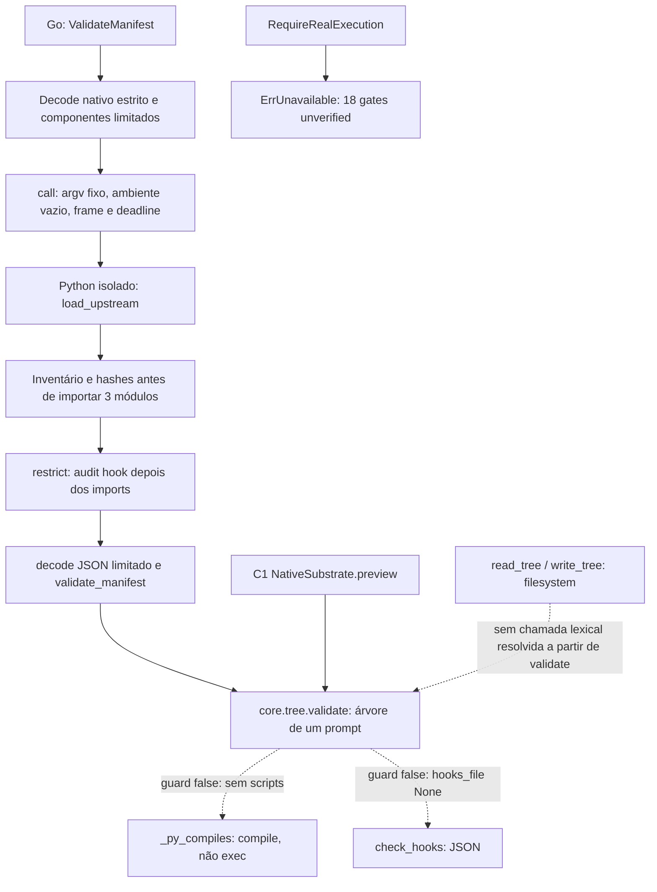

# DA-3.3 — revisão contextual e triagem rastreável

Base: PR #31, HEAD `5d206e58d3973f06c3bb2564b20d7967ba79219a`.
Branch `feature/da3-3-contextual-review`, PR draft para
`feature/da3-2-upstream-security`. O commit upstream continua
`1cfe254e8d25b15f37048c3730134686abe60335`, sem alterações.

## Resultado e significado da classificação

Os 61 achados Bandit e 479 sinais AST permanecem no bundle original DA-3.2 e
continuam sendo gerados no CI. A revisão anota cada um por ID estável, ferramenta,
regra, arquivo, linha/coluna, hash da fonte e hash da linha. Nenhuma anotação é
usada como filtro, nosec, baseline de supressão, downgrade de severidade ou PASS.

| Classificação contextual | Registros | Significado restrito |
| --- | --- | --- |
| Vulnerabilidade confirmada | 1 | Defeito de integridade/reuso em runmark; não uma RCE no DAIMON |
| Risco contextual mitigado | 13 | Sinks de core/tree.py bloqueados pelo contrato atual de integração, não seguros para qualquer chamador |
| Falso positivo demonstrado | 5 | Dois alertas do seed público em assign_ids e três escalares que não são credenciais |
| Inconclusivo | 521 | Modelo de atacante/fluxo/impacto ainda não concluído; continuam visíveis |

Os 540 registros são agrupados em 200 grupos arquivo/função; cada grupo preserva
todos os IDs e regras de origem. Grupo não equivale a vulnerabilidade distinta.
Não se declara revisão profunda de segurança concluída para os 521 inconclusivos.
Sua classificação conservadora registra o trabalho pendente por função/efeito.

`automation/context-review.json` é a decisão humana versionada, com 540 entradas,
justificativas, referências e hashes da integração. O código de verificação não
aceita um falso positivo genérico: exige claim específico e fonte compatível.
Nova fonte, commit, finding ou alteração de fronteira invalida a revisão. O
processo CI revalida o scanner original e recalcula inventário, grupos e grafo.

## HIGH — selection

`harness2/core/selection.py:73`, B324, função `assign_ids`, linhas 71–76.
Entrada: `task_id`, `k`, `mode` e labels públicos. O SHA-1 é truncado a 12 dígitos
hexadecimais, convertido em uma semente de 48 bits para `random.Random`; a saída
embaralha labels ordenados e retorna um mapa de aliases enumerados para labels.
`run_selection` usa esse mapa na montagem/apresentação dos candidatos.

Conclusão: **falso positivo demonstrado quanto ao uso criptográfico de SHA-1**.
Não há segredo, assinatura, autenticação, autorização ou aceitação de integridade
em `assign_ids`. O B311 em `selection.py:75` tem a mesma causa e decisão. Isso não
prova imparcialidade do experimento, anonimato forte, segurança da seleção inteira
nem imprevisibilidade: a função é deliberadamente pública e determinística.

Evidências: fonte e função vinculadas por hash, grafo lexical e
`test_high_shuffle_is_public_determinism`. Nenhuma execução de selector/LLM foi
realizada. Trocar SHA-1 aqui não resolve os outros dois HIGH nem é necessário
para corrigir a vulnerabilidade encontrada no fluxo de reuso.

## HIGH — runmark

`harness2/core/runmark.py:50`, B324, função `fingerprint`, linhas 41–61.
Cada arquivo gera a sequência `nome_relativo + NUL + conteúdo + NUL`; os registros
são concatenados sem comprimento. O hash é truncado a 16 hexadecimais (64 bits).
`mark_complete` persiste esse valor; `is_complete` compara o marcador com o
fingerprint atual para permitir reuso de resultados. Há consumidores reais de
`RM.is_complete` nos adapters de benchmarks, inclusive WorkBuddy.

Defeito confirmado de **serialização ambígua antes do hash**:

| Árvore A | Árvore B |
| --- | --- |
| arquivo a, conteúdo `x\0b\0y` | arquivo a, conteúdo `x`; arquivo b, conteúdo `y` |

As duas árvores produzem `a\0x\0b\0y\0`. Não é necessário atacar SHA-1; trocar
apenas por SHA-256 preservaria essa colisão de entrada. O marcador de uma árvore
pode ser aceito para a outra pelo código original de reuso.

Escopo: o atacante precisa controlar os bytes da árvore entregue ao fluxo de
fingerprint/reuso de benchmarks. Não é uma colisão forjada do SHA-1, uma RCE,
escape de sandbox ou quebra do hashing SHA-256 nativo do DAIMON. O contrato atual
da ponte aceita somente um prompt em memória e não importa runmark nem chama os
benchmarks; o defeito não é demonstrado como explorável pela API atual do DAIMON.
Marcas em disco também pressupõem diretórios confiáveis: framing não autentica
um marcador que um adversário já possa reescrever.

Provas: `test_unframed_collision_requires_no_hash_attack` demonstra a igualdade
dos bytes e a separação por framing. `test_context_original_runmark_collision`
exige Linux descartável sem root e opt-in exclusivo da receita CI existente;
verifica o hash original e executa somente o módulo runmark revisado sobre dois
diretórios temporários privados. Confere fingerprints iguais e aceitação cruzada
por `is_complete`. Não há launcher, benchmark, provider, rede, candidato ou VM.
O resultado real desse teste deve constar no run do PR antes de aceitar a prova.

Correção proposta, sem aplicação automática: framing inequívoco de nomes e bytes
(comprimentos explícitos/domínio/versão), SHA-256 completo, leitura fail-closed,
versão nova de marcador e invalidação de caches antigos. Não basta marcar
`usedforsecurity=False`. Na integração, manter runmark fora dos módulos carregados
e não expor reuso de benchmarks; esses controles já existem e foram preservados.

## HIGH — WorkBuddy

`harness2/benchmarks/workbuddy.py:611`, B324, função `run_batch`.
Entrada: label, nome do subset e lista de tarefas. O SHA-1 truncado a 8 hexadecimais
(32 bits) compõe o nome de um YAML mutável, junto ao label sanitizado/truncado a
40 caracteres. O arquivo é escrito com `write_text`, passado por nome ao processo
`uv run ... --job slug` e removido no finally. `_label_lock` usa o label original
como chave e é somente um lock de threads do processo.

Conclusão: **inconclusivo**, não um falso positivo automático por ser um slug.
Não é um token de autenticação, porém colisões de namespace e falta de ownership
entre labels/processos podem afetar configuração de jobs. A alcançabilidade por
um atacante, controle dos labels e impacto de concorrência no runner externo não
foram comprovados. Nenhum processo desse fluxo foi executado.

Menor mitigação futura a revisar antes de habilitar esse caminho: arquivo privado
exclusivo por job, identificação não truncada com ownership e cleanup exatos, e
coordenação entre processos. A execução permanece desabilitada no DAIMON atual.

## Quatro módulos carregados e grafo aproximado

Os __init__ do pacote/core apenas definem namespaces; core/tree.py fornece
SurfaceSpec/validate. O adaptador C1 carrega ainda substrate/base.py, com contratos
e dataclasses. A integração não importa config, runmark, selection ou os launchers.
As fontes completas continuam analisadas, inclusive as que não são importadas.

O grafo completo tem nós por módulo/classe/função, chamadas resolvidas por escopo,
arestas de integração explicitamente revisadas e chamadas externas/dinâmicas não
resolvidas. Guarda de branch é conservadoramente não resolvida. Há caminhos
aproximados até check_hooks e _py_compiles porque a análise inclui os ramos; os
contratos e testes demonstram que eles não são tomados nas entradas aceitas hoje.
Ausência de caminho lexical não é prova geral de inalcançabilidade: callbacks,
aliasing, reflexão, métodos e imports dinâmicos permanecem limitações explícitas.

## Fronteiras de confiança e efeitos

| Fronteira | Entradas/controles | Limite da conclusão |
| --- | --- | --- |
| Chamador Go → bridge | Config de deployment confiável; manifest validado nativamente; só health/capabilities/validate_manifest | Config não é entrada de modelo/browser; cliente opcional, separado de Sessions/providers |
| Go → processo Python | exe/argv fixos, `-I -S -B`, env vazio, scratch privado, stdin liberado após ownership, frame 96 KiB e deadline | Não contém Python adversarial; stdlib/interpreter/mesmo UID são confiáveis |
| Fonte instalada → imports | lista, hashes, licença e commit antes de exec de snapshots | Audit hook vem depois do import; não é sandbox nem atestação do produtor |
| JSON → worker | chaves/tipos exatos, duplicatas rejeitadas, bytes/profundidade limitados, erros públicos reduzidos | JSON é dados; não substitui quotas/isolamento operacional |
| Worker → validate | só systemprompt.md, texto <=8192 bytes, scripts/plugins/skills/subagents/outros componentes vazios; hooks desabilitados | Não generalizar para read_tree/write_tree ou chamadores diretos do upstream |
| Adapter → upstream | árvore em memória, mesma validação, operações de instalação/execução recusadas | Adapter não concede permissão de ferramenta nem autoridade humana |
| Python → Go | resposta estrita, revision/operations/result coerentes; execution/os_sandbox devem ser false | Resposta upstream não habilita execução ou os gates |
| Runtime | gates fixos unverified; RequireRealExecution recusa | CI estático/unitário não comprova os 18 requisitos operacionais |

Regressões novas usam mocks sentinela para read_tree/write_tree/check_hooks/
_py_compiles: qualquer chamada inesperada falha antes de efeito. Payloads com texto
de código, URL, caminho e JSON permanecem strings inertes; componentes adicionais
são rejeitados antes de chamar upstream. Teste separado prova que compile não
executa o código. Não são testes de containment nem uma autorização para candidatos.

## Outros falsos positivos específicos

B105 em jobbench.py:1063 é o booleano de avaliação `all_pass=False`, não senha.
B105 em jobbench.py:1099 é o sentinela vazio após falha de consulta de credencial,
seguido por recusa quando o token falta; não uma credencial hardcoded. B105 em
third_party/lab_runner/opencode/run_opencode.py:36 é OUTPUT_TOKEN_MAX=64000,
orçamento de saída e não segredo. As demais operações desses módulos, incluindo
consulta gcloud, launchers e filesystem, continuam inconclusivas. Nenhuma consulta
de autenticação ou chamada externa foi feita nesta revisão.

## Unresolved flows

Cada um dos 521 registros inconclusivos mantém sua referência e grupo. São
principalmente fluxos opcionais de subprocessos, filesystem e JSON, além de
execução dinâmica e rede fora dos quatro módulos. Declaração de módulo não
carregado não é uma declaração de segurança do código upstream completo. Extras,
transitivos vendorizados, shell scripts e comportamento de build/import não
ganham cobertura por esse grafo. Nenhum scanner adicional foi instalado.

## Evidência CI e política de aprovação

A lane obrigatória security-triage reutiliza o scanner do mesmo run sem repeti-lo.
Seu resultado contém o JSON original, hash, 540 decisões e grafo reproduzido.
O agregador compara os bytes originais e exige as identidades dos quatro testes
de regressão Linux bem-sucedidos no job independente de integração. O relatório
de integridade pode ser PASS enquanto a segurança permanece FAIL/UNVERIFIED.

Mudança de finding, revisão incompleta, adjudicação genérica, hash alterado ou
prova de CI ausente falham fechado. A lane original security-upstream mantém os
540 registros e FAIL. Security-triage registra o defeito confirmado e FAIL;
521 inconclusivos e limitações continuam explícitos. security-python Git segue
UNVERIFIED. Não há promoção automática, supressão ou CI verde artificial.

Estados: FAIL para defeito confirmado/evidência contraditória; BLOCKED para
evidência original indisponível; UNVERIFIED para lacunas de contexto/cobertura;
NOT RUN para fluxos externos não exercitados; PASS para integridade/testes
efetivamente comprovados, sem inferir a segurança integral do upstream.

Os 122 testes de automação incluem casos de identidade, deriva de fonte/integração,
escopo de falso positivo, agrupamento, grafo incompleto, finding perdido/novo,
indisponibilidade, adjudicação inválida e provas de teste ausentes/duplicadas.
Run ID e tentativa são argumentos obrigatórios explícitos: a remoção deliberada
de metadados do ambiente dos scanners não autoriza fallback de identidade.
Os quatro testes funcionais novos devem executar no CI sem skips; a prova
runmark usa exclusivamente arquivos privados e o módulo original verificado.
Resultados definitivos, SHA/run/tentativa, logs e manifestos ficam no PR e no
relatório final local. Histórico DA-3.2 e FAIL anteriores permanecem intactos.

## Menor próxima intervenção

Preparar um patch revisável do fluxo runmark (framing, hash completo e versão de
marcador/cache), com a prova de colisão convertida em regressão que exija rejeição
do reuso incorreto. O upstream não foi modificado nesta tarefa. Até revisão e
integração explícitas, conservar o contrato DAIMON de quatro módulos e o bloqueio
de execução/reuso de benchmarks. Depois priorizar o HIGH WorkBuddy e os fluxos
inconclusivos de maior efeito; não adicionar scanners para substituir essa revisão.

PR #28/C2, autorização humana e os 18 gates unverified preservados. Sem VM,
operação privilegiada, atualização do upstream, novo serviço ou merge.
