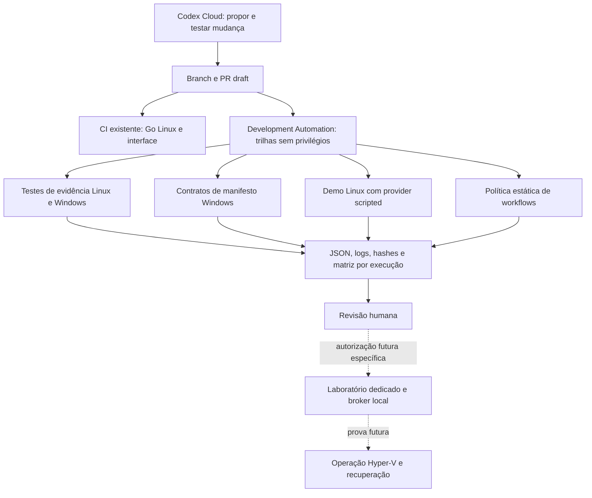

# DAIMON Development Automation

Plano técnico e primeira entrega não privilegiada — 25/10/2026.
Base auditada: `main` em `76a81cff335d54480f3e9ef42ca60b6459d34dfc`.
Branch independente: `feature/daimon-development-automation`. Não inclui os commits
do PR #28. Nenhum arquivo ou evidência da Phase C2 é alterado por esta frente.

## 1. Auditoria do código e do CI atual

| Origem | Automatizado na main | Limitação da evidência |
| --- | --- | --- |
| `.github/workflows/ci.yml`, job `linux` | gofmt, vet, `go test -count=1 ./...`, race; Ubuntu 24.04, Go pelo go.mod, CGO ativo | Testes condicionais podem ser pulados; não certifica Windows/Hyper-V |
| Mesmo workflow, job `ui` | Node 24, npm ci, typecheck, Vitest, build, diff do bundle embutido | Não executa os smokes Playwright |
| `internal/harness2bridge/bridge_test.go`, `integrationConfig` | Chamado por Go, mas integração depende de duas variáveis `DAIMON_HARNESS2_TEST_*` | Sem Python/site configurados ocorre `t.Skip`; verde não comprova worker real |
| `internal/harness2substrate/substrate_test.go` | Contratos C1 e cenários estruturais | Worker real opcional; C1 não autoriza execução de candidatos |
| `python/harness2_bridge/test-linux.sh`, Dockerfile, uv.lock e verify_pin.py | Receita existente de integração Linux, Python 3.12 e pin upstream | Não chamada pelo workflow principal; requer ambiente/dependências próprios |
| `ui/scripts/*smoke.mjs` | Smokes já escritos, em parte com Docker, browser e providers fake | Disponíveis manualmente, não automaticamente cobertos pelo job UI |
| `internal/harness2substrate/gates.go` | 18 declarações `unverified`; recusa de execução real | São requisitos, não atestações |
| PR #28 em `451a2f6` (observação separada) | Testes PowerShell offline e receitas operacionais C2 | Não integrado à main; não copiar/modificar nesta tarefa |

O último CI da main observado passou no run
[39982315031](https://github.com/netty-linux/daimon/actions/runs/39982315031).
Essa observação histórica não é resultado de um novo commit. Push e PR disparam
o CI atual separadamente, podendo duplicar trabalho. Não há, na main auditada,
job Windows, matriz de evidências, artefatos de teste, scanner dedicado ou deploy.

## 2. Arquitetura proposta e primeira implementação



**Implementado agora:** workflow adicional `development-automation.yml`, sem
substituir o CI existente. Cinco execuções seguras: tooling Linux/Windows,
`go test -json ./internal/harness2` no Windows, demo CLI existente no Linux e
política estática. Um job final agrega os resultados, inclusive após falha, quando
seu runner consegue iniciar. Cancelamento total/indisponibilidade do Actions pode
impedir esse job: sem evidência agregada não se deve inferir PASS.
Actions fixadas por commit; checkout sem credenciais persistidas; token somente
`contents: read`; sem secrets, runner self-hosted, elevação, Docker, UAC ou API paga.
Não existe workflow que despache operações privilegiadas.

**Fronteiras planejadas:**

| Trilha | Ambiente | Entrada/saída | Permissão futura |
| --- | --- | --- | --- |
| Linux | Runner padrão descartável | Formatação, vet, unitários, symlink, race e demo | Sem elevação; CI atual preservado |
| Windows | Runner padrão descartável | Contratos portáveis; depois worker/Job tests explicitamente selecionados | Sem Hyper-V/serviços; sem certificação Windows 10 por equivalência |
| Integração Python | Runner Linux descartável | Python 3.12, upstream verificado e dependências travadas, testes reais da ponte | Sem credenciais externas; setup efêmero aprovado e reproduzível |
| Integração browser | Runner Linux descartável | Playwright/Chromium travados, fake provider, workspace temporário | Priorizar smoke.mjs sem Docker; outros precisam receita própria |
| Segurança | Job separado | Política estática agora; futuramente scanners Go/npm e revisão de dependências | Sem autorreparo, merge ou promoção de evidência |
| Independência offline C2 | Executor dedicado validado | Dois cenários, relógio, ownership, cleanup, Job/console | Somente helpers próprios; sem VM; fonte de PR #28 após revisão/integração |
| Operação C2 | Hardware Windows dedicado | VM exata, preflight, lease, journal e prova de recuperação | Autorização humana para cada operação privilegiada |
| Entrega/release | Futuro ambiente protegido | Artefato do SHA aprovado, revisão e promoção manual | Nenhum deploy ou merge automático nesta entrega |

## 3. Matriz e semântica dos cinco estados

Inventário versionado: `automation/coverage.json`. Cada execução gera matriz
instanciada; o inventário não contém PASS preventivo. O escopo acompanha o estado.

| Estado | Significado |
| --- | --- |
| PASS | Escopo declarado realmente executado e comprovado nesta revisão/tentativa |
| FAIL | Teste/critério ou integridade de evidência falhou; não reinterpretar como sucesso |
| BLOCKED | Pré-requisito conhecido impede execução válida, por exemplo laboratório ou autorização |
| NOT RUN | Não executado neste workflow; inclui job ausente/cancelado, não inferir PASS de outro job |
| UNVERIFIED | Resultado/prova insuficiente, teste pulado, log incompleto ou requisito ainda sem comprovação |

Há linhas distintas para os jobs existentes, worker Python, browser, scanner,
independência offline, Hyper-V, gates e configuração do Codex Cloud. Os jobs
existentes aparecem NOT RUN **nesta matriz** até existir importação autenticada de
seus resultados; continuam executando no seu workflow original.

O coletor aceita somente comandos fixos. Go exit zero sem teste executado não é
PASS; `skip` vira UNVERIFIED com os nomes registrados. Unittest precisa confirmar
testes executados e conclusão sem skip. A demo precisa apresentar seus dois
marcadores existentes. Runtime ausente ou OS incompatível vira BLOCKED, sem instalar.
Falhas/timeouts não viram PASS. Somente PASS retorna zero em cada trilha.

O job agregador retorna zero se as cinco trilhas seguras entregaram PASS e seus
artefatos estão íntegros. **O estado global da matriz continua BLOCKED** enquanto
operação/laboratório estiverem bloqueados; gates continuam UNVERIFIED. O verde do
job é saúde do relatório, não homologação operacional. Resultado ausente, duplicado,
adulterado, de outro SHA/run/tentativa ou checkout sujo reprova a agregação.

## 4. Codex Cloud e GitHub Actions

A documentação oficial consultada atualmente chama a página de ambientes de
**Codex Cloud (Legacy)**. Não pressupor acesso, migração ou API de disparo compatível
na conta do usuário. O ambiente documentado usa container, checkout, setup e
manutenção de cache; não é um host Hyper-V. Antes de habilitar, confirmar qual
produto/ambiente está disponível e a cota contratada.

Receita proposta para a configuração humana do ambiente, sem habilitá-la agora:

1. Vincular somente o repositório necessário e respeitar AGENTS.md; selecionar o
   SHA da tarefa. Restringir escrita ao branch de desenvolvimento e saída a PR draft.
2. Selecionar Go compatível com `go.mod`, Node 24 e Python 3.12. Instalar somente
   dependências de desenvolvimento travadas no container descartável; sem root,
   serviços permanentes, acesso ao host ou dados reais. Revalidar pins ao retomar cache.
3. Permitir rede de setup apenas para distribuidores necessários; agente sem rede
   por padrão. Sem secrets de produção/laboratório. O setup documentado tem fase
   própria; não presumir que exports temporários persistam para a fase do agente.
4. Rodar os mesmos comandos versionados de CI, registrar o que foi NOT RUN e enviar
   diff para revisão. Codex propõe correções; testes determinísticos decidem critérios.
5. Solicitar aprovação humana antes de qualquer nova integração paga, segredo,
   alteração de política de branches, release ou acesso privilegiado.

A Codex GitHub Action documentada usa chave API e permissões próprias; Windows
documenta estratégia `unsafe`. **Não está habilitada:** não é requisito para a
primeira entrega de custo incremental zero e não é apropriada ao broker Windows.
Integração futura opt-in deve ser Linux, em job sem privilégios, com teto de gastos,
prompt revisado, código de origem não confiável sem secrets e nenhuma escrita/merge
automática. Não criar uma action que se autorrepare e execute a alteração elevada.

Fontes oficiais consultadas em 25/10/2026:
[ambientes](https://learn.chatgpt.com/docs/environments/cloud-environment),
[Codex Action](https://learn.chatgpt.com/docs/github-action),
[uso e limites](https://learn.chatgpt.com/docs/pricing).
Cloud e uso local compartilham limites do plano; nenhum preço/assinatura ou crédito
foi contratado ou presumido por esta tarefa.

## 5. Laboratório Windows dedicado — projeto, não provisionamento

**Estado atual: BLOCKED.** Não foi selecionado hardware, registrado runner,
instalado serviço, criado ambiente GitHub ou tocada VM. Não oferecer migração do
Windows 10 Pro do usuário. Hardware separado já disponível evita compra, mas sua
existência/licença/suporte/ESU não estão comprovados. Se não existir equipamento
adequado, o laboratório não pode ser prometido a custo zero.

Dimensionamento inicial de capacidade, sujeito a medição: CPU com virtualização
assistida e SLAT, quatro ou mais threads, SSD com espaço para imagens/artefatos,
16 GiB de RAM como candidato mínimo de hardware e 32 GiB preferível para folga.
Isso **não reduz nem substitui** as reservas, quotas ou perfis aprovados da C2.
VM e teste real só após aplicar o preflight da versão revisada, incluindo requisitos
de memória, integridade, patches e recuperação. Sem GPU. Não certificar nested
virtualization em runner público nem habilitar Hyper-V em runner compartilhado.

Separar autoridade em três partes:

- **Controle:** repositório privado de execução confiável ou mecanismo equivalente,
  sem PRs arbitrários/forks. Nunca ligar runner com capacidade de host ao repositório
  público aceitando código de qualquer PR. Labels não são barreira de segurança.
  Acesso, plano e regras desse repositório ainda precisam ser confirmados.
- **Runner:** conta local sem admin/Hyper-V Administrators, dedicada e descartável
  por job quando possível, iniciado como processo apenas durante janela autorizada,
  sem serviço permanente no host pessoal. Recolhe pedido/relatório; não ganha poder
  administrativo por variável de workflow, nome de branch ou CI verde.
- **Broker/guardião local confiável:** código revisado e fixado fora do checkout do
  job; elevação humana explícita, identidade de VM/operação exatas, journal protegido,
  aprovação com SHA, ação, quotas, prazo, validade e nonce de uso único. Sem comando
  genérico ou scripts recebidos de PR. ACLs isolam runner do código/journal administrativo.

Environment GitHub com revisão obrigatória, branches permitidos e bypass proibido
é uma barreira adicional, **não substitui autorização local específica**. Verificar
as regras via API antes de aceitar uma operação: apenas escrever `environment:`
não comprova proteção, pois GitHub pode criá-lo sem regras. Se plano/configuração
não permitirem a proteção, operação permanece BLOCKED.

O watchdog deve sobreviver ao runner, helper, terminal e cancelamento do job.
Iniciar a cadeia autorizada em contexto separado comprovado; medir Job/console em
cada processo. Não assumir que UAC, runner efêmero ou console novo removem Job.
Não usar breakaway ou contorno de segurança. Se não houver independência, BLOCKED.
O broker conserva responsabilidade e journal mesmo se o Actions desaparecer.
Guardiões só podem agir sobre o alvo exato autorizado. Encerramento/restauração
devem ser comprovados antes de reutilizar o laboratório. Estado final desconhecido
interdita novas operações e exige recuperação humana.

Referências GitHub: [self-hosted](https://docs.github.com/en/actions/concepts/runners/self-hosted-runners),
[environments](https://docs.github.com/en/actions/how-tos/deploy/configure-and-manage-deployments/manage-environments),
[uso seguro](https://docs.github.com/en/actions/reference/security/secure-use).

## 6. Remover etapas manuais sem perder independência

Os scripts do PR #28 ficam onde estão. O roadmap é integrar/adotar aquela versão
apenas em tarefa própria após revisão, sem criar cópia divergente nesta branch.
Não converter a recusa segura por Job em "teste passou". Dois cenários positivos
continuam obrigatórios: helper paralisado e saída de controlador/supervisor, com
watchdog sobrevivente e operacional, prazo, ownership e cleanup completo.

A automação futura substitui parâmetros digitados e transcrição de resultados por
pedido/relatório estruturados, preservando o ponto humano de autorização. Antes do
ensaio real, comprovar a cadeia do executor com processos fictícios próprios,
incluindo cancelamento de runner/terminal, falha parcial e recuperação. Depois,
uma autorização separada para a VM exata e operação delimitada. Não induzir pane
do host/Hyper-V nem matar serviços para produzir evidência de independência.

Um processo comum do Actions pode herdar Job: executar o script lá não prova a
independência que o teste requer. O teste de ambiente pode falhar corretamente,
mas os cenários positivos continuam NOT RUN/BLOCKED. Hashes não corrigem essa lacuna.

## 7. Relatórios, logs e evidências versionadas

Cada trilha escreve diretório novo com:

- `report.json`: schema v1, SHA real do checkout, dirty flag, run/tentativa, OS,
  Python/imagem, comando fixo, exit/status, razão e skips; nenhuma alegação operacional.
- `raw.log`: saída do comando, limitada a 2 MiB no artefato. Truncamento impede PASS.
- `summary.md`: tabela para o resumo do job.
- `manifest.json`: tamanho e SHA-256 de cada arquivo do bundle.

O agregador baixa somente artefatos desta tentativa; valida hash, tamanho, schema,
SHA, run/tentativa e escopo. Não executa conteúdo baixado. SHA-256 detecta alteração;
**não é assinatura de produtor nem prova independente de que código de PR é honesto**.
Os resultados de PR são informativos e não concedem autoridade ao laboratório.

Schema, código, inventário e este plano são versionados no Git. Artefatos completos
ficam no Actions com retenção de um dia; logs do Actions mantêm sua política própria.
Para conservar uma evidência além da retenção, baixar e revisar o bundle e incluir
resumo sanitizado/hashes/link/SHA por PR de evidência, com autorização e revisão.
Não há autobot escrevendo logs binários, segredos ou resultados na main.
Relatórios antigos FAIL nunca são sobrescritos ou reclassificados por uma nova execução.

Limites: o spool temporário pode crescer durante o comando; 2 MiB limita o artefato,
não implementa quota de disco do processo. Timeout de 240 s interrompe somente o
filho direto e não atesta cleanup de descendentes. O timeout do job é limite adicional
em runner descartável; **este coletor não é o watchdog nem o rollback da C2**.
Sem telemetria persistente, dump do ambiente ou credenciais externas.

## 8. Custos e limites

Repositório público confirmado na auditoria. Runners hospedados **padrão** são
gratuitos para esse uso; larger runners são cobrados e não foram selecionados.
Armazenamento de artefatos tem franquia compartilhada com Packages, não armazenamento
gratuito ilimitado. Retenção de um dia e logs pequenos reduzem uso; confirmar a
franquia e orçamento do proprietário antes de ampliar retenção/volume. Objetivo de
planejamento: até 1 MiB/run típico e orçamento limitado de armazenamento; não é medição
nem garantia de consumo. Nenhuma forma de pagamento ou orçamento foi alterada.

Self-hosted não cobra minutos do Actions, mas hardware, eletricidade, manutenção,
Windows e cobertura de atualizações têm custo. Reutilização licenciada pode evitar
desembolso novo; não prometer Windows/ESU grátis. Codex depende do plano/cota existente;
API paga e Codex Action ficam opcionais e desabilitados. Sem GPUs, nuvem Windows paga
ou avaliação temporária apresentada como solução gratuita permanente.

Fonte: [GitHub Actions billing](https://docs.github.com/en/billing/concepts/product-billing/github-actions).
O workflow novo só roda em PR, push na main e disparo manual; cancela execução
anterior da mesma ref. A duplicação push+PR do workflow antigo continua como dívida
separada para não alterar o CI/C2 nesta frente inicial.

## 9. Roadmap e critérios de aceitação

| Marco | Entrega | Critério verificável | Estado inicial |
| --- | --- | --- | --- |
| DA-1 (esta branch) | Auditoria, matriz e coleta não privilegiada Linux/Windows | Testes da evidência e cinco trilhas PASS; PR draft e artifacts conferidos | Implementado; validar execução do PR |
| DA-2 | Importar os resultados do CI existente sem duplicar testes; Python/browser reproduzíveis | SHA/run correto, skips explícitos, ambiente travado e sem secrets | Planejado |
| DA-3 | Scanners Go/npm/dependências, gates de release separados | Falha/rede indisponível distintas; sem autorreparo/merge | Planejado |
| DA-4 | Configuração humana do Codex Cloud no produto disponível | Conta/cota/ambiente comprovados; comandos iguais ao CI; nenhum acesso privilegiado | UNVERIFIED |
| DA-5 | Hardware/licença/patches e executor dedicado aprovados | Conta mínima, ACL, approval/nonce e independência de processos comprovados offline | BLOCKED |
| DA-6 | Uma execução operacional C2 autorizada, evidência e recuperação | Preflight aprovado, autorização exata, Off/deadline/RAM/journal comprovados | BLOCKED |

Não há merge automático, instalação de runner local ou execução operacional como
parte desta entrega. Os 18 gates continuam `unverified`; qualquer homologação futura
exige sua própria evidência/revisão, fora desta infraestrutura de desenvolvimento.

## 10. Uso local seguro

```text
python -I -B -m unittest discover -s automation/tests -v
python automation/policy.py
python automation/evidence.py --lane automation-windows --output .automation-results/local-windows
python automation/evidence.py --lane windows-contracts --output .automation-results/local-contracts
```

Usar diretórios novos; não apagar evidência para permitir repetição silenciosa.
No Linux, trocar para `automation-linux` e `linux-demo`. Checkout sujo é registrado
e não é aceito como evidência agregada da revisão limpa. Nenhum comando acima acessa
VM, serviços Hyper-V, aplicações do usuário ou scripts operacionais da C2.
